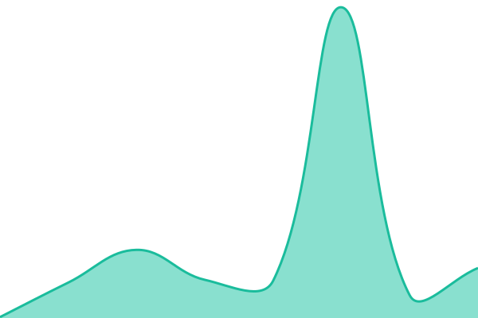

# [📈 Live Status](https://mbachmay.github.io/EGeoSG-upptime): <!--live status--> **Alle Seiten sind verfügbar**

This repository contains the open-source uptime monitor and status page for [mbachmay](https://mbachmay.github.io/EGeoSG-upptime), powered by [Upptime](https://github.com/upptime/upptime).

With [Upptime](https://upptime.js.org), you can get your own unlimited and free uptime monitor and status page, powered entirely by a GitHub repository. We use [Issues](https://github.com/mbachmay/EGeoSG-upptime/issues) as incident reports, [Actions](https://github.com/mbachmay/EGeoSG-upptime/actions) as uptime monitors, and [Pages](https://mbachmay.github.io/EGeoSG-upptime) for the status page.

<!--start: status pages-->
<!-- This summary is generated by Upptime (https://github.com/upptime/upptime) -->
<!-- Do not edit this manually, your changes will be overwritten -->
<!-- prettier-ignore -->
| URL | Status | History | Response Time | Uptime |
| --- | ------ | ------- | ------------- | ------ |
|  [DevViewer](https://dev-map.geo.sg.ch/viewer/) | Verfügbar | [dev-viewer.yml](https://github.com/mbachmay/EGeoSG-upptime/commits/HEAD/history/dev-viewer.yml) | 

 64ms
     
 | 

<a href="https://mbachmay.github.io/EGeoSG-upptime/history/dev-viewer">91.75%</a>
    

|  [MigrationsViewer](https://dev-map.geo.sg.ch/migration/) | Verfügbar | [migrations-viewer.yml](https://github.com/mbachmay/EGeoSG-upptime/commits/HEAD/history/migrations-viewer.yml) | 

 43ms
     
 | 

<a href="https://mbachmay.github.io/EGeoSG-upptime/history/migrations-viewer">100.00%</a>
    

|  [Prod Viewer](https://map.geo.sg.ch/viewer) | Verfügbar | [prod-viewer.yml](https://github.com/mbachmay/EGeoSG-upptime/commits/HEAD/history/prod-viewer.yml) | 

 294ms
     
 | 

<a href="https://mbachmay.github.io/EGeoSG-upptime/history/prod-viewer">100.00%</a>
    

<!--end: status pages-->

[**Visit our status website →**](https://mbachmay.github.io/EGeoSG-upptime)

## 📄 License

- Powered by: [Upptime](https://github.com/upptime/upptime)
- Code: [MIT](./LICENSE) © [Anand Chowdhary](https://anandchowdhary.com)
- Data in the `./history` directory: [Open Database License](https://opendatacommons.org/licenses/odbl/1-0/)
